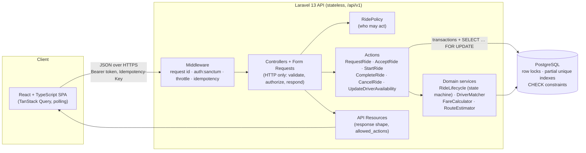
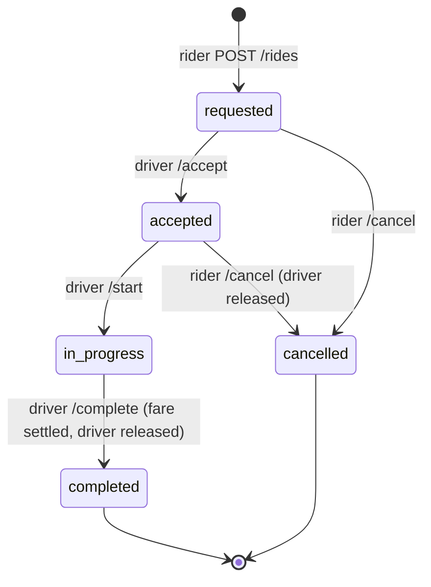

# Architecture & design notes

## 1. System overview



**Layers and their responsibilities**

| Layer | Location | Responsibility |
| --- | --- | --- |
| Frontend | `frontend/src` | UI, input UX, loading/empty/error states, retries with idempotency keys, polling |
| HTTP handlers | `app/Http/Controllers/Api/V1`, `app/Http/Requests`, `app/Http/Resources` | Validation, authorization, mapping domain results to JSON |
| Business logic | `app/Actions`, `app/Services`, `app/Enums/RideStatus.php` | Ride lifecycle, matching, pricing, invariants |
| Persistence | `app/Models`, `database/migrations` | Schema, constraints, relationships |
| Cross-cutting | `app/Http/Middleware`, `app/Exceptions` | Request ids, idempotency, consistent error envelope |

### Data model

```mermaid
erDiagram
    users ||--o| drivers : "has profile (role=driver)"
    users ||--o{ rides : "requests (rider_id)"
    drivers ||--o{ rides : "assigned (driver_id)"
    rides ||--o{ ride_events : "audit trail"
    users ||--o{ idempotency_keys : owns
    users ||--o{ personal_access_tokens : owns

    users { bigint id PK; string email UK; string role "rider|driver"; string phone }
    drivers { bigint id PK; bigint user_id FK,UK; string vehicle_category; string vehicle_plate UK; string status "offline|available|on_trip"; decimal latitude; decimal longitude }
    rides { ulid id PK; bigint rider_id FK; bigint driver_id FK "null until accepted"; string category; string status; string pickup_address; decimal pickup_latitude; decimal pickup_longitude; int distance_meters; int estimated_fare; int final_fare; jsonb fare_breakdown; timestamp requested_at; timestamp accepted_at }
    ride_events { bigint id PK; ulid ride_id FK; string from_status; string to_status; bigint actor_id FK; bigint driver_id FK }
    idempotency_keys { bigint id PK; bigint user_id FK; string key; char request_fingerprint; smallint response_status; jsonb response_body; timestamp locked_until }
```

* **Riders** are `users` with `role = rider`; **drivers** are users with a `drivers` profile (vehicle, category, availability, last location).
* **Driver assignment** is `rides.driver_id` + `accepted_at`; `ride_events` keeps the full history of who moved a ride to which state.
* **Fare information** is stored on the ride as an upfront quote (`estimated_fare` + `fare_breakdown` snapshot) and the settled `final_fare`. Amounts are integers (whole PKR), never floats.
* Ride ids are **ULIDs**: not enumerable, sortable, safe to expose.

Invariants enforced **by PostgreSQL**, not just by code:

| Constraint | Guarantees |
| --- | --- |
| `rides_one_active_per_rider` (partial unique on `rider_id` where status is active) | A rider can never hold two active rides, even under duplicate concurrent requests |
| `rides_one_active_per_driver` (partial unique on `driver_id` where status is accepted/in_progress) | A driver can never be assigned two active rides |
| `rides_assigned_driver_check` | accepted / in_progress / completed rides always have a driver |
| `rides_completed_fare_check` | completed rides always have a final fare |
| `*_status_check`, `*_category_check` | no invalid enum values |
| `drivers_available_requires_location_check` | an available driver always has a location (needed for matching) |

### Ride state machine



The transitions live in one place, `App\Enums\RideStatus::allowedTransitions()`, and every status write goes
through `RideLifecycle::transition()`, which validates the transition, writes the audit event and logs it.
**Policies decide *who* may act (403/404); the state machine decides *whether the ride's state allows it* (409).**

## 2. Answers to the architecture questions

### Q1. Why this technology stack and architecture?

* **Laravel 13 (PHP 8.4) for the API.** It is the stack I am most productive and rigorous in, and it covers what
  this problem needs out of the box: first-class database transactions and row locking, validation, policies,
  rate limiting, token auth (Sanctum), structured logging with context, and an excellent HTTP test layer (Pest).
  That let the time budget go into the hard parts (concurrency, idempotency, state machine) instead of plumbing.
* **PostgreSQL**, because correctness here depends on database features: `SELECT … FOR UPDATE`, partial unique
  indexes, CHECK constraints and `INSERT … ON CONFLICT DO NOTHING`. Tests run against PostgreSQL too (not SQLite),
  so they exercise the same locking and constraint behaviour as production.
* **React + TypeScript SPA (Vite, TanStack Query)** as the brief prefers. TanStack Query gives loading/error state,
  retry policy, cache invalidation and polling declaratively, so server-state handling is consistent across the app.
  The SPA is a separate app that only talks to the public API, the same contract a mobile app would use.
* **A modular monolith with an action/service layer.** One deployable unit is the right call at this scale;
  module boundaries (`Actions` per use case, `Services` for matching/pricing/lifecycle) keep business logic
  framework-light and testable, and are the seams along which services could be extracted later (see Q6).

### Q2. How do you prevent two drivers from accepting the same ride?

Three layers, in `App\Actions\Rides\AcceptRide`:

1. **Pessimistic row lock.** Inside a transaction the ride row is read with `SELECT … FOR UPDATE`. Concurrent
   accepts for the same ride queue on that lock; the first commits `status = accepted, driver_id = X`; each one
   that follows re-reads the *committed* row, sees it is no longer `requested`, and gets `409 ride_already_assigned`.
2. **Driver lock + eligibility under the lock.** The driver row is then locked too (always *ride first, then
   driver* in every action, so lock ordering cannot deadlock), and availability, category and distance are checked
   while both rows are locked. This also stops one driver from accepting two rides at once.
3. **Database backstop.** The partial unique index `rides_one_active_per_driver` (and the status CHECKs) make a
   double assignment impossible even if application code regresses.

This is proven by `tests/Concurrency/ConcurrentRideOperationsTest.php`, which starts 6 **separate PHP processes**
that all accept the same ride at the same instant against the real database and asserts exactly one wins. As a
mutation check, removing `lockForUpdate()` makes that test fail with all 6 drivers "winning".

I chose pessimistic locking over optimistic versioning because contention on a popular ride is exactly the
expected case, the critical section is a few milliseconds, and it gives the losers a precise error.

### Q3. How do you handle retries and duplicate requests?

* **Idempotency keys** (`App\Http\Middleware\EnsureIdempotency`, IETF `Idempotency-Key` draft). Required on
  `POST /rides`, accepted on ride actions. The key is claimed atomically with `INSERT … ON CONFLICT DO NOTHING`
  (scoped per user). The response is stored; a retry with the same key and payload **replays** it
  (`Idempotent-Replayed: true`) without re-executing. Same key + different payload → `422`; a retry while the first
  is still running → `409` + `Retry-After`; 5xx responses are not stored so they stay retryable; a key stuck
  "in progress" after a crash is reclaimed after a lock timeout. Keys are pruned after 24 h (`model:prune`).
* **Natural idempotency / business guards** as a second line: a rider can have only one active ride (pre-check +
  partial unique index, proven by a concurrent-process test with 5 simultaneous requests → 1 ride), and an accept
  repeated by the driver who already holds the ride returns the ride instead of an error.
* **Client side**: the SPA generates one key per logical operation and reuses it for every retry of that
  operation (automatic retries after network errors, or the user pressing "Try again"), and generates a new key
  only when the user changes the request or after a definitive 4xx (`useIdempotentMutation`).

### Q4. How does the frontend respond when an API request fails?

* Every failure becomes a typed `ApiError` carrying the server's stable `code`, `message`, field errors and
  `request_id`; transport failures and timeouts (15 s) become `code: network_error`.
* **Reads** retry automatically (2 times, exponential backoff) only for retryable failures (network, 5xx, 429),
  never for 4xx. If they still fail, an inline error with **Try again** and the support reference is shown; the
  rest of the page stays usable. Polling failures on a live ride show "Live updates paused — reconnecting…"
  while keeping the last known state.
* **Writes** retry automatically on network failure with the same idempotency key (safe by design). Business
  errors are shown in context: validation messages beside the field, `409` conflicts as an explanation (e.g. "This
  ride has already been accepted by another driver"), after which the affected data is refetched.
* `401` anywhere clears the session and returns to sign-in with a "session expired" notice.
* Buttons show progress and are disabled while a request is in flight, so double-clicks don't send double requests.

### Q5. How would you scale to multiple cities and thousands of concurrent users?

* **Stateless API, horizontally scaled** behind a load balancer (it already is stateless: bearer tokens, no
  server sessions). Use Octane/FrankenPHP for throughput, PgBouncer for connection pooling.
* **Partition by city.** Add a `city_id`/market to drivers and rides, with per-city configuration (tariffs,
  service area polygon, matching radius) instead of the single `config/rides.php`. Contention is naturally local
  to a city, so later the busiest cities can get their own database shard or regional deployment.
* **Geo-indexed matching.** Replace the bounding box + haversine with PostGIS (`geography` column, GiST index,
  `ST_DWithin` / KNN `<->` ordering) or, at higher write rates, keep live driver positions in **Redis GEO** or H3
  cells, fed by a driver-location stream (drivers ping every few seconds; we do not want those writes on the
  primary database).
* **Dispatch instead of first-come accept.** Rank nearby drivers (ETA, rating, acceptance rate) and offer the ride
  to one driver at a time with a short timeout, or batch-match. The accept path keeps the same lock/constraint
  guarantees.
* **Push, not polling.** Replace polling with WebSockets/SSE (Laravel Reverb or a managed service) driven by
  domain events, so thousands of riders don't poll every 3 s.
* **Read replicas** for history/reporting, keeping the transactional core on the primary; archive completed rides.

### Q6. When would you introduce Redis, a message broker, or separate services?

* **Redis**: as soon as there is more than one API instance: cache, rate-limiter and lock store (today these use
  the database), queue backend, and the live driver-location index (GEO). This is the first step to take.
* **Message broker** (SQS/RabbitMQ/Kafka): when side effects multiply and must not slow down or break the request
  path: notifications, receipts, analytics, payouts, fraud checks. I'd publish domain events (`RideRequested`,
  `RideAccepted`, …) through a **transactional outbox** so events are never lost or emitted for rolled-back
  transactions. Kafka specifically when we need replayable high-volume streams (driver locations, pricing signals).
* **Separate services**: only when there is an organizational or scaling reason: e.g. a **location/matching
  service** with very different load characteristics (high-frequency writes, in-memory geo), **payments** for
  compliance isolation, or **pricing** when it becomes a separately owned, fast-moving domain. The Actions/Services
  boundaries in the monolith are the extraction seams; until then a modular monolith is cheaper to operate and keeps
  transactions simple.

### Q7. Deployment, monitoring and rollback

* **Build once, promote**: CI (tests, Pint, PHPStan, type checks, `composer audit`) builds an immutable container
  image tagged with the git SHA; the SPA is built to static assets and served from a CDN. The same artefact goes
  staging → production. Laravel Cloud, or ECS/Kubernetes, works for the API.
* **Config & secrets** come from the environment/secret manager (never the image or repo); `config:cache` at boot.
* **Zero-downtime releases** with rolling or blue/green deploys and readiness checks (`/up`); migrations follow
  expand/contract so the previous version keeps working against the new schema during and after a deploy.
* **Monitoring**: structured JSON logs carrying `request_id` (already propagated via `Context` and returned in
  responses and error bodies), error tracking (Sentry/Nightwatch), metrics and alerts on the golden signals
  (latency, error rate, saturation) plus business SLOs: time-to-accept, % rides with no driver, 409 rate on accept,
  idempotency replays, cancellation rate. Tracing with OpenTelemetry once there are multiple services.
* **Rollback**: redeploy the previous image tag (one click/command) and, preferably, switch risky behaviour behind
  **feature flags** so it can be turned off without a deploy. Because migrations are backward compatible, rolling
  back code does not require rolling back the schema; destructive schema changes ship only in a later release.
  Canary releases (small % of traffic) with automatic rollback on error-rate alerts.

### Q8. The three most important improvements before production

1. **Real-time dispatch & live location.** A dispatch loop that offers rides to the best driver with timeouts and
   re-dispatch (including when a driver cancels), live driver location ingestion, and push updates to riders
   instead of polling. This is the core product experience and the main scaling risk.
2. **Real identity and payments.** Phone/OTP sign-up, driver onboarding & verification, refresh-token rotation,
   and a payments flow (fare authorization at request time, capture on completion, cancellation fees) with an
   outbox-based event pipeline for receipts and payouts.
3. **Operational hardening.** Observability (metrics, tracing, alerting on the SLOs above), Redis for
   locks/rate limits/cache, PostGIS matching, load tests of the accept path, a geocoding/routing provider instead of
   the static place list and straight-line estimates, and security reviews (abuse limits per rider, audit of PII
   access, data retention).
